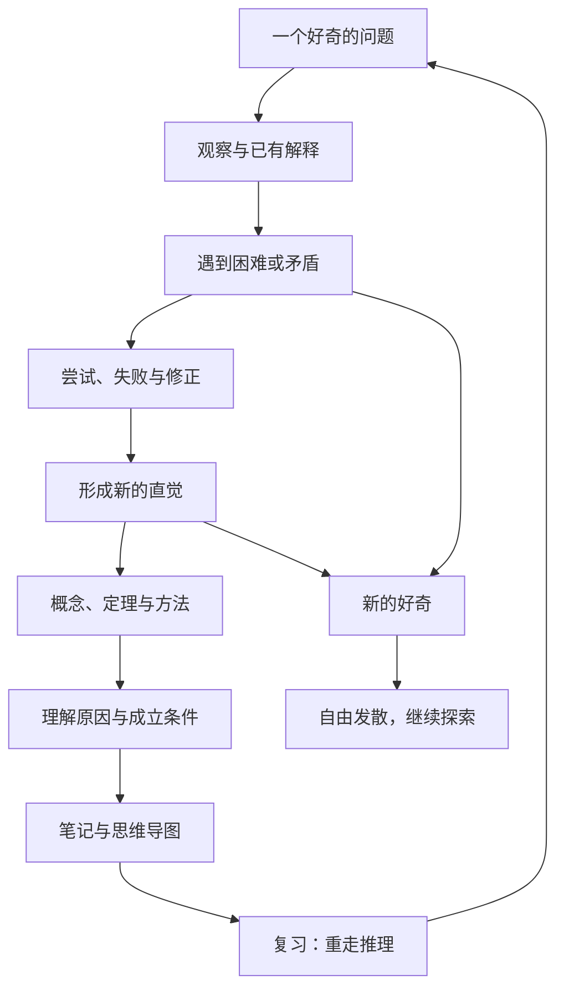

## 一条可以生长的探索路径

## 图中的关系是什么意思

- **问题在前，结论在后。** 先理解为什么需要一个解释，新的概念才有落脚点。
- **尝试与修正属于正文。** 它们说明哪些障碍塑造了最终的方法。
- **理解包含条件。** 不只知道结论，还要知道它在什么情况下成立。
- **记录让探索可以重走。** 笔记展开原因，导图呈现关系，复习把二者重新连起来。
- **发散不需要获准返回。** 新的问题可以继续生长，不必用它服务原来的课程目标。

这张图是共同约定的学习方式，不是对所有知识发现史的概括。
