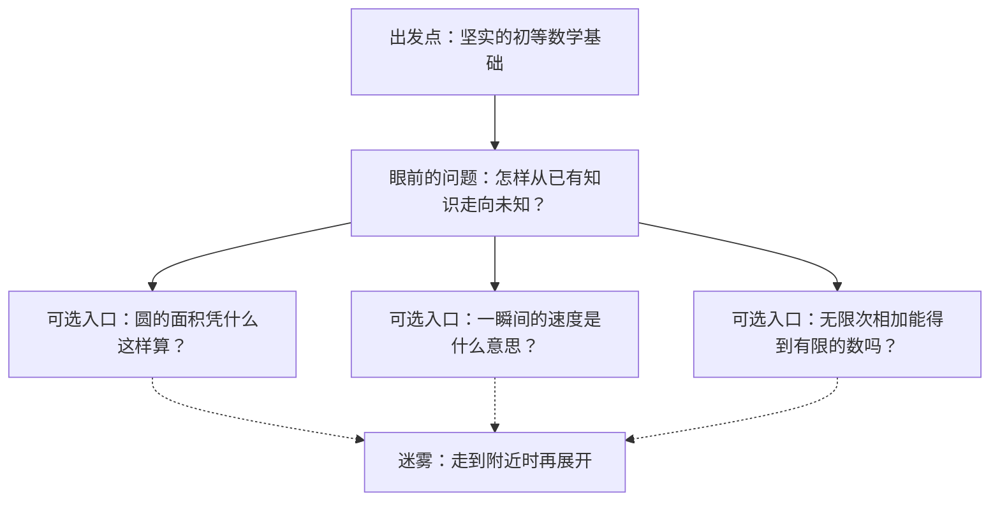

## 我们从哪里出发

学习者学过高等数学，但很多概念已经遗忘，计算和证明方法也不够扎实。本主题按“有坚实初等数学基础、尚未学习高等数学”组织讲解；遇到曾经见过的内容，可以重新发现，也可以在确认理解后直接经过。

目标是理解数学问题如何出现、方法为何有效、证明如何成立。探索不设山顶，也不要求走完整套课程。

## 探索的约定

- **问题先于术语。** 先遇到值得解决的问题，再看已有工具卡在哪里，最后给需要的新概念命名。
- **地图随探索生长。** 只展示已走过的地方、正在研究的问题和相邻的少量岔路。远处保留迷雾，不提前铺满章节和先修清单。
- **自由选择方向。** 好奇心可以改变路线；暂时停下、返回旧问题和长期沿支线探索都成立。
- **计算要亲手走过。** 在当前问题需要的地方，一起展开代数变形、几何构造和估算，解释每一步的理由。计算也是检验猜想、寻找反例和发现结构的工具。
- **证明保留来路。** 说明为什么想到这一步、尝试解决什么障碍、依赖哪些条件，以及改变条件后会怎样。先看清一个具体例子，再决定是否抽象。
- **原始文献参与探索。** 每次精读一小段：交代问题和符号，保留关键原句，给出中文释义，再重走计算与论证。原文中的缺口和历史上的不严密之处也值得讨论。

自由的是探索方向，严格的是推理中“这一步为什么成立”。需要补充的知识就在当地解释；如果补充本身更有趣，可以沿它继续走。

## 怎样阅读数学家的工作

材料会明确区分：

1. **历史文献：** 作者留下的文本、图、计算、信件或手稿，标明版本与位置。
2. **教学重构：** 为帮助理解而安排的尝试、失败和推理，标明是我们的重构。
3. **我们的探索：** 实际提出的问题、做过的计算、形成的猜想和修正。

原始著作也可能是整理后的论证。我们根据文献讨论可见的发现线索，不把重构写成作者未曾留下的心理活动。

已经备好一段开场材料：[阿基米德：发现一个结果，和证明它，是两件事](/mathematics/discovery-and-proof/)。这是供共同阅读的导读，尚不代表学习者已经读过或理解了其中的论证。

## 眼前的地图

这三条是可选入口，没有先后顺序，也不是必做清单。箭头表示可探索的方向，不表示已经掌握或严格的先修关系。

- **面积入口：** 熟悉圆面积公式以后，我们还能追问：为什么它必须成立？有限个直边图形怎样帮助我们处理曲边？
- **速度入口：** 平均速度用一段时间计算。如果时间只剩“一瞬间”，我们究竟还在算什么？
- **无限入口：** 每次前进剩余路程的一半，有限次永远留下一点距离。“越来越接近”和“等于”有什么关系？

暂定建议从面积入口开始：先用三角形、多边形和面积比较提出问题，再按需要打开新的工具。最终方向等待学习者选择。

## 迷雾与知识边界

给遇到的问题分别标记：

- **待探索：** 我们还没理解，或暂时没有尝试。
- **已有解答：** 已找到可核查的结论与适用条件，仍可比较不同方法。
- **猜想或证明缺口：** 我们有理由相信，但论证还没有完成。
- **研究前沿：** 查证后确认，在明确条件下仍未解决的问题。

“我们不知道”与“数学界还不知道”分开记录。遇到研究前沿时，先看清问题、已知结果和现有方法卡在哪里；可以讨论和尝试，不把随手的思路当作突破。

## 当前记录

- 已明确：学习起点、探索方式、原始文献的阅读方式。
- 已备材料：阿基米德《方法》开篇的发现与证明之别。
- 待选择：第一个数学问题。
- 尚无共同走完的高等数学证明，也没有记录任何概念为“已经掌握”。

后续笔记保留实际走过的推理、算过的例子、误解的修正和仍然悬着的问题。复习从这些问题重新进入。
